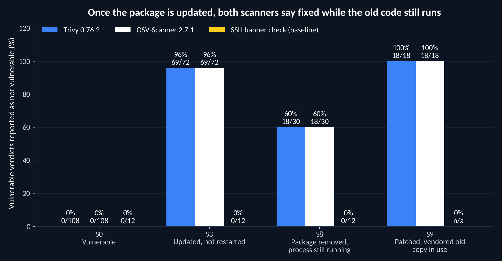
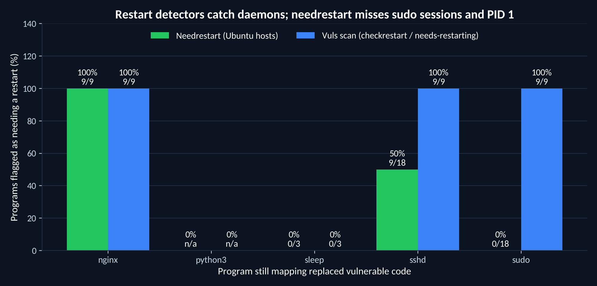
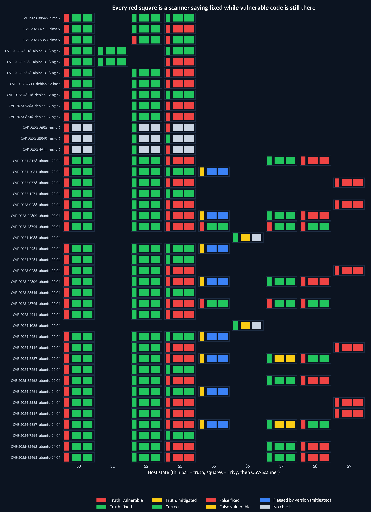
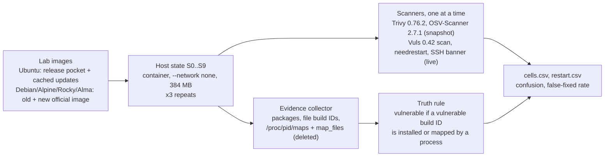
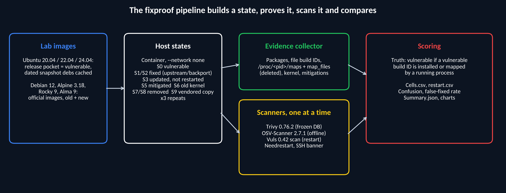

# fixproof

[](https://github.com/itsashutoshpsingh/fixproof/actions/workflows/ci.yml)


**On hosts where the package was updated but the long-running programs were not restarted, Trivy and OSV-Scanner said "not vulnerable" in 138 of 138 verdicts (23 CVE x distro cells, 3 repeats each) while the old vulnerable code was still mapped in memory.**

Correct verdicts per host state, all repeats ([`results/tables.md`](results/tables.md), every verdict in [`results/cells.csv`](results/cells.csv)):

| State | What the host looks like | Truth (vuln / fixed / mitigated) | Trivy 0.76.2 | OSV-Scanner 2.7.1 | SSH banner check* | fixproof verify** |
|---|---|---|---|---|---|---|
| S0 | Vulnerable package installed | 117 / 0 / 0 | 108/117 | 108/117 | 12/12 | 117/117 |
| S1 | Fixed by a new upstream version | 0 / 6 / 0 | 6/6 | 6/6 | | 6/6 |
| S2 | Fixed by a vendor backport, restarted | 3 / 108 / 0 | 102/111 | 102/111 | **0/12** | 111/111 |
| **S3** | **Updated, not restarted** | 78 / 39 / 0 | **39/117** | **39/117** | 12/12 | 117/117 |
| S5 | Vendor mitigation, package still old | 6 / 0 / 24 | 6/30 | 6/30 | 6/12 | 6/30 |
| S6 | Old kernel package on disk, fixed kernel running | 0 / 6 / 0 | **0/6** | no check | | 6/6 |
| S7 | Package removed, config files left | 6 / 24 / 0 | 24/30 | 24/30 | | 30/30 |
| S8 | Package removed, process still running | 30 / 0 / 0 | 12/30 | 12/30 | 12/12 | 30/30 |
| S9 | Patched, but an app runs its own old copy | 18 / 0 / 0 | **0/18** | **0/18** | | 18/18 |

\*My baseline: the upstream OpenSSH version from the sshd banner against the CVE's affected range, standing in for an unauthenticated version check (OpenVAS could not run here, see limits). \*\*This repo's own check on the same evidence; shown for completeness, not as a competitor. The 9 S0 misses for each scanner are all Rocky Linux, where neither scanner has a check for the three CVEs (finding 4). S5: no tool credits a mitigation; they report by version, which is correct by version.

Hosts were built into known states for 22 public CVEs on Ubuntu 20.04/22.04/24.04, Debian 12, Alpine 3.18, Rocky Linux 9 and AlmaLinux 9 (114 host builds, 1,455 scored verdicts). No exploit was used: the truth is known by construction and confirmed by an evidence collector that reads `/proc/<pid>/maps` and the build ID of every mapped file, deleted or not.



## Findings

**1. A clean rescan after patching says nothing about running processes.** In S3 every package on disk is fixed, and 23 cells still had vulnerable code loaded: nginx workers holding the old `libcrypto`/`libssl`, the sshd listener, an open root `sudo` session, PID 1 holding the old glibc loader. Trivy and OSV-Scanner reported every one of them as not vulnerable (69 of 69 verdicts each; 95% interval 95 to 100%). Both tools are package-version scanners by design, so this is expected; the measurement is how often it happens on ordinary hosts. Over all stale-code cells (S3, S8, S9), 210 of 222 verdicts said fixed; the 12 that did not were CVE-2024-6387 on S8 hosts, flagged through `openssh-client`, not because of the running daemon. On the 108 verdicts where the stale process is the one that would run the vulnerable path for new input (TLS workers, the vendored library, and sshd where the probe showed it), 96 said fixed and the other 12 are those same `openssh-client` flags.

**2. Not every stale process is exposed, and the truth should say so.** For sshd this was measured: the probe opens one TCP connection (no login) and checks the process that serves it. On 20.04 and 22.04 the stale listener's executable is deleted but the child serving the new connection runs the new binary, because sshd re-executes itself for each connection, so the old code is in memory but not reachable through new connections. On 24.04 the child kept the deleted binary in all three builds, so there the stale listener is reachable, and its banner still announced the old package revision (`OpenSSH_9.6p1 Ubuntu-3ubuntu13`) after the upgrade (probe table in [`results/tables.md`](results/tables.md)). I had assumed the re-exec held everywhere; the probe said otherwise. The glibc loader bug (CVE-2023-4911) is reached only on a new exec. The iconv bug (CVE-2024-2961) lives in a converter module loaded on first use; no process had it loaded, so S3 is genuinely fixed for it, and the scanners were right. Each call is written down per CVE in `cases/*.yml`, and the tables give both the strict and the reachable count.

**3. Restart detectors help, but they are not CVE closure.** needrestart (Ubuntu hosts) flagged nginx in 9 of 9 and sshd in 9 of 18 builds, missed sshd every time the package had been removed (S8), and never flagged the open sudo session (0 of 18) or PID 1 (0 of 3): 18 of 48 stale programs overall. Vuls's fast-root scan, the one scanner that documents restart detection, flagged 27 of 30 where its check could run (nginx, sshd and sudo every time; PID 1 never), but its check could not run on 21 of the 38 host states: the 15 Debian, Alpine, Rocky and Alma states (no sudo, checkrestart or needs-restarting in those images; no restart check at all for Alpine) and the 6 Ubuntu states where sudo had been removed, because it calls `sudo checkrestart` even as root. Neither tool raised a false restart alarm on any host without a stale process.



**4. On Rocky Linux 9.2 neither scanner flagged Looney Tunables.** Trivy and OSV-Scanner flagged 0 of 9 vulnerable verdicts on `rockylinux:9.2.20230513` (CVE-2023-4911, CVE-2023-2650, CVE-2023-38545). Rocky's errata feed as exported to OSV has no RLSA-2023:5453 or RLSA-2023:3722, and its curl record names the source package `curl` while the image installs `curl-minimal`. The 9.3 image's own rpm changelogs name all three CVEs. AlmaLinux, built from the same sources, is fully covered (9 of 9 for both).

**5. Backports break version-string checks, not package scanners.** On backported hosts (S2) the package scanners raised 0 false alarms in 198 verdicts; the banner check flagged all 12 fixed sshd builds as vulnerable, because `OpenSSH_8.9p1` is the upstream version whatever the Ubuntu revision says.

**6. Package-level edge cases.** With `openssh-server` removed (S7), both scanners still reported CVE-2024-6387 through `openssh-client` (6 of 6 builds each; the tracker lists the fix for the `openssh` source package). Trivy flagged the old kernel package left on disk in all 6 S6 builds although the running kernel is fixed; OSV-Scanner had no kernel finding at all. When the vulnerable package was removed while its process kept running (S8), the sudo CVEs were reported fixed in 18 of 18 verdicts per scanner. An application's own copy of an old OpenSSL (S9) was invisible to both scanners: 18 of 18 false fixed.



## What this means for a vulnerability management team

- A clean rescan proves the files are fixed. To close a ticket for a library or daemon, also require no process mapping a deleted copy of the affected file (`grep -l '(deleted)' /proc/*/maps`, `needrestart -b`, or `fixproof verify`), or a reboot.
- "Updated, not restarted" is the default outcome for shared libraries on a real host: no maintainer script restarts the programs that use glibc or OpenSSL.
- Version-string (banner) checks overstate risk on Debian-family and Red Hat-family hosts; authenticated package checks do not, but they in turn trust the vendor feed, which can be missing advisories (Rocky).
- A documented mitigation is invisible to every tool here; track it as an exception with its own evidence.
- SLA numbers built on "closed on clean rescan" count S3, S8 and S9 hosts as remediated.

## fixproof verify: an evidence pack for a remediation ticket

`fixproof verify CVE-2024-6387 CVE-2023-0286` on a host (or `--container NAME` in the lab) checks the installed version against the vendor's fixed version, every process that maps a deleted or unowned copy of the affected file, the running kernel, the mitigation check and the vendor changelog, and exits non-zero unless all are clean. Scored on the same evidence it matched the truth on all 441 non-mitigated verdict slots; it is my tool and uses the same evidence as the truth, so this shows it is consistent, not that it is independent. Example output from a 22.04 S3 host: [`results/verify_demo/ubuntu-22.04_S3.txt`](results/verify_demo/ubuntu-22.04_S3.txt).

## Method



- **Hosts.** Containers (no KVM here), each with its own filesystem, package database and processes, no network. Ubuntu packages come from the release pocket (vulnerable) and a dated `snapshot.ubuntu.com` view of `-updates`/`-security` (fixed), cached at build time so states are built offline with real `apt-get upgrade`. Debian, Alpine, Rocky and Alma archives are unreachable from this lab, so their before/after states are two dated official images, and "updated, not restarted" writes the newer image's files over the running host by rename, as dpkg/rpm/apk do. Image digests: [`results/lab_images.json`](results/lab_images.json).
- **CVEs.** 22 public CVEs (OpenSSH, glibc, sudo, polkit, OpenSSL, curl, xz/gzip, the kernel); fixed versions from the vendors' trackers, cited in each [`cases/*.yml`](cases).
- **Truth.** Vulnerable if an affected package older than the vendor's fixed version is installed, or a running process maps an object whose build ID (sha256 on Alpine, which ships no build IDs) belongs to a vulnerable version. Mitigated if the vendor's mitigation is in force and covers every vulnerable package. Fixed otherwise. Full definitions: [`docs/method.md`](docs/method.md).
- **Scanners.** Trivy and OSV-Scanner scan a snapshot of the live host with frozen feeds (the OSV database is filtered to the studied CVEs; on one host per distro the full export gave identical verdicts, [`results/osv_full_db_check.json`](results/osv_full_db_check.json)); Vuls, needrestart and the banner check run on the live host. A scanner that never flags a CVE on any vulnerable host of a distro is scored "no check" there, not "fixed".
- **Repeats.** Every host built three times from scratch; 485 of 485 (cell, scanner) verdicts and 155 of 155 truths were identical across repeats.



Other charts: [confusion matrices](docs/img/confusion.png), [backports and leftovers](docs/img/backport_banner.png), [coverage by distro](docs/img/coverage.png).

## Prior art

I could not find an open benchmark that builds hosts into known remediation states and scores host scanners against what is actually running. Closest: SVS-TEST ([arXiv 2512.17710](https://arxiv.org/abs/2512.17710v1)), which scores SBOM scanners against hand-built SBOMs, and a 2026 ground-truth study of dependency scanners ([2604.21111](https://www.emergentmind.com/papers/2604.21111)); both stop at package versions. Restart detectors (needrestart, checkrestart, KernelCare uchecker) find stale libraries but are not benchmarked against known states. Details: [`docs/prior_art.md`](docs/prior_art.md).

## What went wrong

Full list: [`docs/what-went-wrong.md`](docs/what-went-wrong.md). Limits: [`docs/limits.md`](docs/limits.md).

- OpenVAS/Greenbone, Wazuh, Grype, OpenSCAP with vendor OVAL and the Vuls detection database could not run: their feeds or registries are blocked from this lab, and Greenbone also needs more memory than the 3.5 GB cap. The CVE-scanner columns are therefore two scanners, and the authenticated-versus-unauthenticated OpenVAS comparison from the plan is not here.
- No VMs, so no "new kernel installed, old kernel running" state (S4). S6 uses the lab's own fixed kernel.
- Only the Ubuntu hosts were upgraded by a real package manager; the other four distros use an image overlay.
- My first scoring said Vuls flagged nothing (PID namespace mismatch), my first "restarted" state still had PID 1 on the old glibc, my Terrapin mitigation check passed on a host with no sshd, and my first Alpine truth missed the stale libcrypto because Alpine binaries have no build ID. All four were caught by cross-checks and fixed before the final run.
- The reachable/not-reachable split and the choice of affected binary package per CVE are my judgments, written down per case.

## Reproduce

```bash
make setup          # uv sync (Python 3.13, pinned in uv.lock)
make tools feeds    # osv-scanner 2.7.1 and vuls 0.42.0 from the Go proxy; trivy DB; filtered OSV DB
make lab            # Ubuntu lab images (needs archive.ubuntu.com and snapshot.ubuntu.com)
make run            # 38 host states x 3 repeats, about 80 minutes, one host at a time
make charts test    # score, tables, summary.json, charts, tests
make rescore        # or: recompute every table and chart from the committed raw data only
```

Raw evidence and scanner output for every build are in `results/raw/<distro>/<state>/r<n>/` (gzip JSON). CI re-scores them on every push and fails if the published tables no longer follow. Feed versions: Trivy DB `UpdatedAt 2026-11-14T13:05:54Z` ([`results/feeds`](results/feeds)); OSV exports downloaded 2026-11-14. Drafts for the maintainers (Rocky errata gap, Vuls sudo dependency): [`docs/upstream-notes.md`](docs/upstream-notes.md).

## Repository layout

```
cases/        one YAML per CVE: fixed versions per distro, files carrying the bug, mitigation, sources
lab/          images.yml, hosts.yml (state recipes), ubuntu/Dockerfile + state scripts, tools/
src/fixproof/ evidence.py (collector), truth.py, lab.py, run.py, scanners/, matrix.py, report.py, charts.py, verify.py
results/      raw/, cells.csv, restart.csv, tables.md, summary.json, headline_numbers.json, feeds/
docs/         method, limits, what-went-wrong, prior_art, upstream-notes, img/
tests/        pytest: version ordering checked against dpkg/rpm/apk, truth rule, verify, parsers
```

MIT licence. Copyright (c) 2026 Ashutosh Pal Singh.
